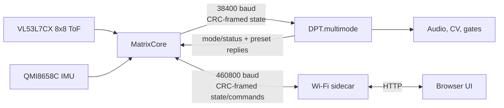

# Bearamin development guide

This guide describes the current implementation contract for contributors.
Start with [`README.md`](README.md) for prerequisites and
[`WIRING.md`](WIRING.md) before connecting hardware.

## Source layout

| Path                                     | Responsibility                                                                                  |
| ---------------------------------------- | ----------------------------------------------------------------------------------------------- |
| `firmware/BearaminMatrixCore/`           | Thin standard MatrixCore production entrypoint                                                  |
| `firmware/BearaminSidecar/`              | Thin standard sidecar entrypoint plus capture-worker asset                                      |
| `firmware/common/`                       | Shared wire protocols and pure logic used by the ESP32 firmware                                 |
| `firmware/libraries/BearaminMatrixCore/` | Realtime app plus target-local matrix sensor/display configurations                             |
| `firmware/libraries/BearaminSidecar/`    | Wi-Fi/web app plus target-local board configurations                                            |
| `third_party/bearfield-core/`            | Pinned portable 8x8 field processing, transforms, feel profiles, and 30 Hz output interpolation |
| `dpt/DPT.multimode/`                     | Audio, CV, gates, SD-card presets, and mode announcements                                       |
| `third_party/mutable/`                   | Pinned Mutable Instruments Rings and stmlib source used by the DPT app                          |
| `hw/Sensor-expander/`                    | Canonical v6 sidecar PCB and hardware notes                                                     |

MatrixCore owns the realtime path. The sidecar must not become a dependency for
sensor sampling, DPT control, or continued performance after boot. The DPT's
physical CV8 input is the sole authority for the selected mode; the browser
only reports that position.

The public release is deliberately narrow:

```text
LICENSE
README.md
DEVELOPMENT.md
WIRING.md
firmware/
  BearaminMatrixCore/
  BearaminSidecar/
  common/
  libraries/
dpt/
  DPT.multimode/
hw/
  Sensor-expander/
third_party/
  bearfield-core/
  mutable/
tools/
  openocd/
```

Local credentials, generated binaries, build caches, logs, test captures,
machine-specific paths, legacy firmware, diagnostic apps, and the prototype
14 HP boards are excluded.

## Data flow



The normal split is deliberate:

- MatrixCore normalizes sensor data and constructs gesture state.
- DPT turns that state into deterministic audio, CV, and gates.
- The sidecar provides control and observability without adding browser or
  network work to either performance-critical path.

## Hardware and wiring

Start with [`WIRING.md`](WIRING.md). The latest non-variant PCB is the
[`v6 sidecar board`](hw/Sensor-expander/bearamin-dpt-sensor-v6.kicad_pcb). It
has one VL53L7CX connection and no separate close-range sensor footprint. The
v6 PCB is the authoritative publication hardware; older board revisions are
excluded from this release.

Eurorack power can damage hardware and connected computers. Verify polarity,
the 5 V buck output, and common ground before connecting the ESP boards or
DPT. Do not connect the Eurorack -12 V rail to the sensor-head buck converter.

## Sensor and processing contract

The VL53L7CX supplies a genuine 64-zone depth frame at 15 Hz. All 64 zones
participate in field processing; no sensor rows are cropped or stretched. The
retired 4x4/60 mode and its protocol/UI controls no longer exist. The retired
single-point sensor path, recovery logic, telemetry, and web UI status also no
longer exist. The processor services display/control output at 30 Hz using
time-based
interpolation between the latest processed targets. Interpolated updates never
claim to be new sensor frames.

Gesture semantics are:

- Z comes from the tracked 8x8 blob.
- X and Y are the cooked blob centroid.
- Positive X means right and positive Y means up in instrument space.
- Each target declares independent sensor and display transforms. Supported
  transforms are quarter-turn rotation, mirror X/Y, active-cell masks, and
  display pixel order/LUT.
- Sensor orientation is applied before processing; display orientation is
  applied only when mapping canonical cells to physical LEDs.

The shared core owns the portable signal path and feel profiles. Board drivers,
sensor recovery, protocol transport, DPT behavior, web UI, and display hardware
remain leaf responsibilities. A new hardware variant should be a thin target
wrapper with explicit capabilities rather than another copy of the processor.

Full 64-cell data is engineering telemetry, not normal performance traffic. It
is sent to the sidecar only while an engineering view or capture explicitly
requests it.

Target sketches never include sibling sketches. The build selects one local
Arduino app library and one compile-time target configuration, so unrelated
sensor/display drivers cannot enter the link accidentally.

## Wire protocols

### MatrixCore to DPT

Current gesture frames begin with `0xA5 0x5A`, carry a versioned payload, and
end with a CRC16-CCITT. The current payload includes:

- sequence and validity flags;
- normalized Z, X, and Y gesture state;
- sensor age and target counts;
- impact gate, velocity, and age;
- packed per-mode mapping controls; and
- six signed mapping-depth values.

The DPT accepts only the current version-10, 64-byte payload. A version or
length mismatch is rejected before decoding. Mapping changes must remain
covered by the host tests in `dpt/DPT.multimode/tests/`.

The reverse link reports selected mode and DPT readiness. The sidecar reaches
that information through MatrixCore; it does not communicate with the DPT
directly.

### MatrixCore to sidecar

Sidecar frames begin with `0xBA 0x4D`, use protocol version 5, and carry a
CRC16-CCITT. MatrixCore sends state at about 20 Hz. The sidecar sends bounded
commands and expects acknowledgements.

The link is considered stale when no MatrixCore state arrives for 500 ms. Raw
8x8 cells use a separate request-driven frame and automatically stop when the
engineering client stops polling.

When extending either protocol:

1. revise the version and update every producer and consumer together;
2. keep parsing bounded and allocation-free on realtime paths;
3. update both endpoints in the same change;
4. add host-side encode/decode or contract coverage; and
5. test mixed stale, truncated, and CRC-invalid input.

## Modes and settings

The selectable order is fixed:

1. Modal
2. Sympathetic Strings
3. Karplus-Strong
4. Bearamin FM drone
5. Bearamin CV

Modal, Sympathetic Strings, and Karplus-Strong share the Rings control model.
FM drone and the Rings modes can map Bearamin X/Y/Z to mode-specific
controls. CV7 is the global gesture amount for mapped offsets.
The Rings Frequency lane has a saved, default-off quantizer. Chromatic, Major,
and Pentatonic Major derive their root from physical CV6 before Bearamin
modulation; mapped XYZ movement then selects notes within that rooted scale.

Bearamin CV outputs fixed direct gesture ranges:

- CV outputs 1-3: X/Y/Z unipolar `0..10 V`;
- CV outputs 4-6: X/Y/Z bipolar `-5..+5 V`;
- Gate 1: proximity/presence; and
- Gate 2: IMU impact.

Presets intentionally do not save or restore the physical CV8-selected mode.
Current mapping keys use stable semantic names such as
`map_bearamin_fm_0_axis` and signed `map_bearamin_fm_0_depth` values.

## Preset transport

The sidecar can download/upload settings JSON in the browser or save/load it
through the DPT SD card. DPT owns the filesystem; MatrixCore only relays the
bounded preset messages. MatrixCore continues sending fresh motion/control
frames between preset replies, and DPT performs at most one bounded SD
operation per main-loop pass without stopping the audio callback.

Preset reads are request-driven:

1. DPT validates and retains the requested file.
2. The sidecar requests an exact 36-byte offset.
3. DPT returns that chunk.
4. The sidecar requests the final offset and receives the end record.
5. Byte count and CRC must match before settings are applied.

At boot, the sidecar waits for MatrixCore state and requests a runtime snapshot
before transmitting settings. MatrixCore reports whether a sidecar has already
initialized its controls since MatrixCore boot. If not, the new sidecar uses
compiled defaults and may load `/presets/default.json`; otherwise it imports
the live MatrixCore controls and does not overwrite them with defaults.

Do not replace this with an unsolicited stream. The request/retry design allows
a lost chunk to be fetched again without restarting or confusing a later
transfer. DPT filesystem reads stay in foreground code, outside the audio
callback.

The initial `BPLS ... READ` request follows the same bounded retry contract as
chunk requests. A duplicate with the active sequence is idempotent: DPT lets an
in-progress read finish, or resends the retained `BPRD BEGIN` after completion,
instead of returning `busy` or rereading the file. This closes the one
request/response boundary that otherwise could exhaust the outer read attempts
after a lost half-duplex reply.

Directory listing retains its completed sequence too. Repeated `BPLS` requests
are ignored while the scan is active and can resend the terminal `END` after
completion. Every item carries its directory index and a name CRC, and `END`
includes the DPT's item count. The Sidecar accepts the list only when every
expected index has a CRC-valid name, otherwise it requests bounded full
replays and fills missing indices. Thus a lost or damaged item or terminator
cannot silently omit or rename a preset, turn a complete scan into a UI
timeout, or duplicate item rows.

DPT waits five milliseconds after the last received command byte before
driving a preset reply. This is long enough for the MatrixCore UART turnaround
and remains below the DPT status transmitter's 15-millisecond idle threshold,
so preset replies neither collide with the command nor invite an unrelated
status transmission into the gap.

Request retries use a 150-millisecond interval. Delayed duplicate read chunks
whose offsets are already committed are ignored and the current exact offset is
requested again; a future offset remains a hard protocol error. Duplicate read
requests, exact-offset chunk requests, and write chunks are idempotent, so a
retry cannot append data twice or restart a completed read. Final byte count
and CRC validation remain mandatory.

Directory-list retries use 500 milliseconds because list items stream from one
scan; DPT also resends a completed terminator only when its preset TX queue is
empty. This prevents stale `END` replies from delaying the immediately
following preset load.

Each `BPD` payload also carries a CRC over its decoded bytes. A damaged read
chunk is discarded and the same offset is requested again; a damaged write
chunk receives no acknowledgement and is retransmitted by the existing
bounded retry. The whole-file size and CRC remain mandatory after these local
checks, so chunk recovery does not weaken commit validation.

Preset write completion is idempotent as well. The sidecar retries `BPWE` with
the original sequence until it receives `BPWR ... OK`. DPT ignores that retry
while the foreground `.tmp` close/replace job is active and retains the last
completed write sequence so it can resend `OK` if the original terminal reply
was lost. A retried `BPWR` begin for the active sequence only resends `READY`;
it never clears data already accepted for that transaction.

Read and write payload chunks are 36 bytes. Including the sequence, offset,
hex data, and chunk CRC, the complete response fits MatrixCore's fixed 96-byte
preset payload even at maximum field widths. This keeps each response atomic
through the relay without changing preset files, storage transactions, or the
public DPTS protocol version.

The MatrixCore-to-DPT wire is half duplex. MatrixCore therefore suppresses
normal control frames while a preset command claims the wire. Command echoes
and intermediate replies do not release or extend the current quiet window.
The first request opens a bounded 200-millisecond burst; a terminal reply
releases it early, otherwise the deadline permits a fresh control frame before
the next burst. This prevents control frames from colliding with each individual
chunk while keeping DPT state inside its 250-millisecond freshness contract.

## Wi-Fi and browser UI

Real credentials belong only in ignored
`firmware/common/wifi_config.h`. The checked-in example contains placeholders.
If `WIFI_SOFTAP_PASSWORD` is empty or shorter than eight characters, the
recovery access point is open.

The default UI polls lightweight state. Raw frames, sensor grids, and detailed
timing are enabled only by an explicit engineering action. Preserve that
boundary: large or frequent JSON responses can interfere with responsive
network service and make sensor behavior harder to diagnose.

Useful endpoints include:

| Endpoint                   | Purpose                                           |
| -------------------------- | ------------------------------------------------- |
| `/status.json`             | Compact readiness, DPT, sensor, and network state |
| `/device.json`             | Main browser-panel state                          |
| `/wifi/diag.json`          | RAM-only Wi-Fi transition history                 |
| `/sensor/matrix.json`      | Cooked 8x8 diagnostics                            |
| `/engineering/matrix.json` | Request-driven raw 8x8 data                       |
| `/presets.json`            | DPT SD-card preset listing                        |
| `/perf.json`               | Opt-in bounded performance snapshot               |

MatrixCore Wi-Fi is normally off. The sidecar's MatrixCore OTA action
temporarily arms it for maintenance and it times out if an upload does not
start.

## Realtime constraints

- Keep SD reads, writes, and WAV preparation out of the DPT audio callback.
- Keep MatrixCore's normal state frames compact and fixed-rate.
- Do not continuously stream raw 8x8 cells.
- Avoid unbounded strings, queues, retries, or filesystem work in the play
  path.
- Treat browser diagnostics as opt-in and self-expiring.
- Preserve the sidecar's ESP32-S3 build profile:
  `PSRAM=opi,LoopCore=1,EventsCore=1`.

## DPT CV hardware note

CV outputs 1-2 use the Daisy native DAC while CV outputs 3-6 use the DPT's
DAC7554 expander. They do not share the same physical conversion path.

The expander requires MSB-first mode-1 data with clock idle low and one
uninterrupted 16-bit word per low SYNC interval. Correlated equal voltages on
multiple expander outputs usually point to framing, addressing, or latch
timing. Independent outputs with the same offset point instead to conversion
or compensation.

Validate channel independence with distinct static voltages before changing
calibration. Then measure minimum, zero, maximum, and intermediate values.

## Build prerequisites

### MatrixCore and Wi-Fi sidecar

Install [Arduino CLI](https://arduino.github.io/arduino-cli/) and the Espressif
`esp32` core, then install these libraries:

```sh
arduino-cli core install esp32:esp32
arduino-cli lib install "Adafruit VL53L7CX"
arduino-cli lib install "Adafruit NeoPixel"
```

Copy the credential template and edit only the ignored local copy:

```sh
cp firmware/common/wifi_config.example.h firmware/common/wifi_config.h
```

`firmware/common/wifi_config.h` is ignored by Git. Never put real credentials
in `wifi_config.example.h` or commit the local file. Set
`WIFI_SOFTAP_PASSWORD` to at least eight characters to protect the recovery
access point; leaving it empty creates an open recovery network.

Compile the sidecar:

```sh
arduino-cli compile \
  --fqbn "esp32:esp32:XIAO_ESP32S3:PSRAM=opi,LoopCore=1,EventsCore=1" \
  --library firmware/libraries/BearaminSidecar \
  firmware/BearaminSidecar
```

Compile MatrixCore with the memory-saving VL53L7CX feature flags:

```sh
arduino-cli compile \
  --fqbn "esp32:esp32:esp32s3:USBMode=hwcdc,CDCOnBoot=cdc,PSRAM=enabled,FlashSize=4M,PartitionScheme=default" \
  --library firmware/libraries/BearaminMatrixCore \
  --build-property "compiler.cpp.extra_flags=-DVL53L7CX_DISABLE_AMBIENT_PER_SPAD -DVL53L7CX_DISABLE_NB_SPADS_ENABLED -DVL53L7CX_DISABLE_SIGNAL_PER_SPAD -DVL53L7CX_DISABLE_RANGE_SIGMA_MM -DVL53L7CX_DISABLE_REFLECTANCE_PERCENT -DVL53L7CX_DISABLE_MOTION_INDICATOR" \
  firmware/BearaminMatrixCore
```

Arduino CLI writes its normal build outputs outside tracked source when you
provide `--build-path` and `--output-dir`; do not commit those generated files.

The VL53L7CX build used by the instrument disables unused per-zone outputs to
reduce memory pressure:

```text
-DVL53L7CX_DISABLE_AMBIENT_PER_SPAD
-DVL53L7CX_DISABLE_NB_SPADS_ENABLED
-DVL53L7CX_DISABLE_SIGNAL_PER_SPAD
-DVL53L7CX_DISABLE_RANGE_SIGMA_MM
-DVL53L7CX_DISABLE_REFLECTANCE_PERCENT
-DVL53L7CX_DISABLE_MOTION_INDICATOR
```

Pass those definitions through your Arduino build system's extra C++ flags.

### DPT firmware

Clone the upstream DPT platform beside this repository:

```sh
git clone https://github.com/joemisra/dpt.git ../dpt
git -C ../dpt checkout 2c00550b1891f3c42ca6f27a0277e40eec3a54fe
git -C ../dpt submodule update --init --recursive
```

Then build the QSPI application:

```sh
make -C dpt/DPT.multimode \
  BEARAMIN_ROOT="$PWD" \
  DPT_PLATFORM_ROOT="$PWD/../dpt"
```

The DPT app expects the Daisy bootloader and is linked for QSPI. See
[`dpt/DPT.multimode/README.md`](dpt/DPT.multimode/README.md) for SD-card
announcements, bridge details, and flashing notes.

## Build and validation

Useful focused checks are:

```sh
make -C dpt/DPT.multimode/tests

make -C dpt/DPT.multimode \
  BEARAMIN_ROOT="$PWD" \
  DPT_PLATFORM_ROOT="$PWD/../dpt"
```

For ESP32 work, compile both endpoints whenever a shared header changes.
Source-level confidence should include:

- DPT host tests;
- sidecar embedded-UI contract checks;
- MatrixCore and sidecar compilation;
- a fresh DPT QSPI build; and
- `git diff --check`.

Hardware confidence additionally requires:

- verifying the exact target before every flash - with three firmwares in the system confusion is easy.
- a verified firmware upload;
- `/status.json` reporting fresh MatrixCore and DPT links;
- browser confirmation that all five modes and controls render; and
- physical CV/audio/gate measurement when the change affects outputs.

## Contribution boundaries

This public repository intentionally excludes machine-local credentials,
generated firmware, logs, captures, local KiCad history, prototype
boards, and operational device-identity records. Please keep new documentation
portable: use repository-relative paths and do not commit serial ports, MAC
addresses, private network details, or workstation paths.
