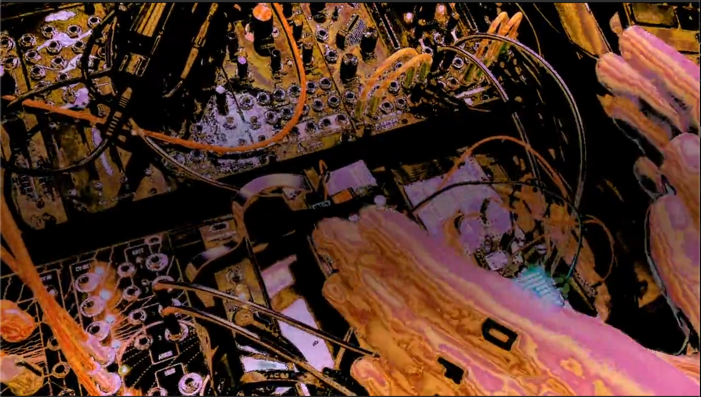

# Bearamin

Bearamin is a three-dimensional optical gestural instrument for Eurorack. A
sensor head tracks a hand in X, Y, Z, pitch, and roll; a realtime MatrixCore
turns that motion into stable musical control; a Wi-Fi sidecar provides the
browser interface; and a [dsp.coffee DPT](https://github.com/joemisra/dpt)
handles the audio, CV, and gates.

## See Bearamin in action

**[Watch “Bearamin Jazz” (2:29)](media/bearamin-jazz.mp4?raw=1)**

This repository is an early hardware and firmware release for builders who are
comfortable with embedded development, Eurorack power, and prototype hardware.
It contains the working five-mode instrument firmware and the routed v6
sensor-expander PCB for review.

## The instrument

Bearamin combines:

- a dsp.coffee DPT with an Electro-Smith Daisy Patch Submodule; and
- a Waveshare ESP32-S3-Matrix real-time core;
- a Seeed Studio XIAO ESP32-S3 Wi-Fi/web sidecar;
- one VL53L7CX 8×8 time-of-flight sensor;
- the Matrix board's QMI8658C IMU and 8×8 RGB LED matrix;
- the v6 sensor-expander PCB that connects the system.

The VL53L7CX acquires the 8×8 depth frames at 15 Hz. Bearamin turns them into
smooth 30 Hz control state for X, Y, Z, pitch, roll, and “Spank”—an impact
gesture triggered by striking toward the sensor.

Portable 8×8 field processing, transforms, and feel profiles are vendored in
`third_party/bearfield-core/`. Bearamin keeps DPT, audio, networking, and board
drivers in this repository.

CV8 on the DPT selects five equal-width performance modes:

1. **Modal** — Mutable Instruments Rings' modal resonator model with some
   feedback and reverb magic.
2. **Sympathetic Strings** — the Rings sympathetic-string model, also with some
   feedback and reverb magic.
3. **Karplus-Strong** — the Rings physical-string model with (you guessed it)
   some feedback and reverb magic.
4. **Bearamin FM drone** — a stereo two-operator gestural FM voice.
5. **Bearamin CV** — direct X/Y/Z CV in unipolar and bipolar ranges, plus
   proximity and impact gates.

The browser UI at [`bearamin.local`](http://bearamin.local/) follows the DPT's
physical mode selector, edits per-mode gesture mappings, exposes resonator and
system controls, and saves presets to the DPT SD card.

The three Rings modes include an optional, saved frequency quantizer. Choose
Chromatic, Major, or Major Pentatonic in the browser; when quantization is
enabled, CV6 selects the root while mapped XYZ movement selects notes within
that scale.

## The future

I'm working to simplify the hardware. Planned directions include an all-in-one
version and a smaller, lightweight CV-only instrument. Watch this space.

## Project status

Bearamin is working firmware for a specific prototype hardware stack—not a
finished commercial module or universal DPT application. If you're interested
in building, testing, or eventually owning one, please
[open an issue](https://github.com/actuallysparky/bearamin/issues).

Developer documentation, build instructions, and hardware guidance live in
[`DEVELOPMENT.md`](DEVELOPMENT.md).

## Feedback and contributions

Build reports, documentation fixes, and hardware review are welcome. The PCB is
still prototype hardware, so please read the development guide and open an
issue before ordering boards or assuming compatibility with a different setup.

## A deep bow to Mutable Instruments

Bearamin's resonator modes would not exist without the extraordinary work of
**Émilie Gillet and Mutable Instruments**. Rings is one of the landmark designs
in open-source musical instrument history: musically generous, technically
beautiful, and documented and shared in a way that enabled an enormous
community to learn, experiment, and create. We are profoundly grateful for
that work and for the care, imagination, and openness behind the entire
Mutable Instruments catalog.

The vendored Rings and stmlib files in `third_party/mutable/` come from
[pichenettes/eurorack](https://github.com/pichenettes/eurorack) at the commits
recorded in that directory's README. Original copyright and MIT license notices
are retained. Bearamin is an independent derivative project and is not
affiliated with or endorsed by Mutable Instruments.

## Full credit to dsp.coffee

**Bearamin is built on the amazing dsp.coffee DPT platform.** DPT is foundational
to the instrument, providing the Daisy-based audio engine, CV and gate I/O,
stereo audio, SD storage, and the rear expansion connection used by Bearamin.

Full credit and enormous thanks go to **dsp.coffee and Joe Misra** for designing
and openly sharing such a capable, hackable musical platform. If Bearamin is
interesting to you, please explore the
[DPT source](https://github.com/joemisra/dpt) and
[dsp.coffee](https://dsp.coffee/).

## Other upstream work

Bearamin also builds on the
[Electro-Smith Daisy ecosystem](https://github.com/electro-smith/libDaisy),
[Espressif's Arduino core](https://github.com/espressif/arduino-esp32),
[ST's VL53L7CX sensor](https://www.st.com/en/imaging-and-photonics-solutions/vl53l7cx.html),
and Adafruit's [VL53L7CX](https://github.com/adafruit/Adafruit_VL53L7CX) and
[NeoPixel](https://github.com/adafruit/Adafruit_NeoPixel) libraries, along with
the open-source embedded community around them.
Their respective licenses and attribution requirements continue to apply.

## License

Bearamin-authored code, documentation, and hardware design files are available
under the [MIT License](LICENSE). Third-party and vendored files remain covered
by their respective upstream licenses and notices.
