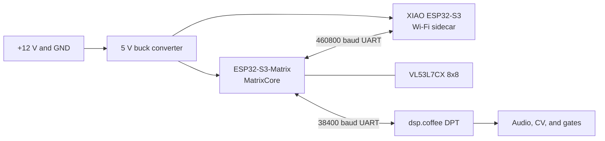

# Bearamin wiring

This is the current split Bearamin build: MatrixCore owns realtime sensing and
the DPT link, while the XIAO ESP32-S3 owns Wi-Fi, the browser UI, and OTA
coordination.

## System diagram

## Power

| Source | Destination | Notes |
| --- | --- | --- |
| Eurorack `+12V` | buck `IN+` | Never connect `-12V` here. |
| Eurorack `GND` | buck `IN-` and DPT `GND` | Common reference. |
| buck `OUT+`, adjusted to 5.0 V | Matrix `5V` and XIAO `5V/VBUS` | Verify before connecting boards. |
| buck `OUT-` | Matrix, XIAO, sensors, and DPT `GND` | All grounds common. |
| Matrix `3V3` | VL53L7CX power | Sensor rail. |

If USB and rack power can be connected simultaneously, add appropriate
power-path protection or use only one supply at a time to prevent backfeeding.

## MatrixCore sensors

| Signal | Matrix pin | Destination |
| --- | --- | --- |
| Optical I2C SDA | `GPIO1` | VL53L7CX SDA |
| Optical I2C SCL | `GPIO2` | VL53L7CX SCL |
| VL53L7CX interrupt | `GPIO4` | VL53L7CX `INT` (optional) |
| VL53L7CX low power/reset | `GPIO5` | VL53L7CX `LPR` |
| Onboard LED data | `GPIO14` | onboard 8x8 RGB matrix |
| Onboard IMU SDA | `GPIO11` | onboard QMI8658C |
| Onboard IMU SCL | `GPIO12` | onboard QMI8658C |

The production target starts one VL53L7CX at I2C address `0x29`. There is no
separate single-point ranging sensor in the current hardware or firmware
contract.

## DPT UART

| Signal | Matrix pin | DPT expansion pin |
| --- | --- | --- |
| Matrix TX to DPT RX | `GPIO33` | `AUX_1 / A2 / PA1 / UART4_RX` |
| Matrix RX from DPT TX | `GPIO34` | `AUX_2 / A3 / PA0 / UART4_TX` |
| Ground | `GND` | `GND` |

The active bridge is 38400 baud, 8N1. UART pins carry signals only; do not use
them to power the sensor head.

## Wi-Fi sidecar UART

| Signal | Matrix pin | XIAO ESP32-S3 pin |
| --- | --- | --- |
| Matrix TX to XIAO RX | `GPIO35` | `D3 / GPIO4` |
| Matrix RX from XIAO TX | `GPIO36` | `D4 / GPIO5` |
| Ground | `GND` | `GND` |

The sidecar link is 460800 baud, 8N1.

## Sensor-expander v6 sidecar board

The latest non-variant editable KiCad sources are:

- `hw/Sensor-expander/bearamin-dpt-sensor-v6.kicad_pro`
- `hw/Sensor-expander/bearamin-dpt-sensor-v6.kicad_pcb`

This board contains the XIAO ESP32-S3 sidecar, ESP32-S3 MatrixCore, VL53L7CX
8×8 sensor connection, DPT link, and power components. It deliberately omits
the former single-point near-sensor footprint and connection. The v6 PCB is
board-authoritative and is not linked to the older v5 schematic. Local KiCad
lock files, local preference files, history, autorouter intermediates, and
fabrication exports are intentionally excluded.
